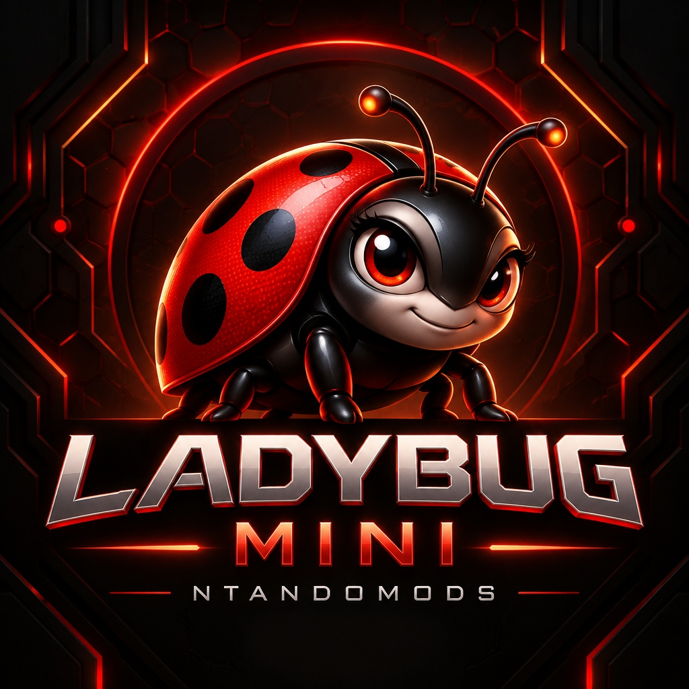

<div align="center">

## 🐞 Ladybug Mini

[](https://github.com/WhiskeySockets/Baileys)
[](https://nodejs.org/)
[](LICENSE)
[](https://github.com/Ntandomods)



</div>

**Ladybug Mini** is a fast, lightweight WhatsApp MD bot built on top of the **Baileys** library, proudly crafted under the **Ntandomods** brand. It is designed to be quick to deploy, easy to customize, and packed with powerful features — without ever touching the core code.

This project is **fully open source** — you can modify it, rebrand it, and build your **own bot** from this codebase **free of cost**, without needing any permission. All commands and the overall structure are written to make customization (bot image, prefix, name, features, etc.) as easy as possible.

---

## ✨ Features

- **🐞 Ladybug Branding** – a bold, custom neon ladybug logo and consistent Ntandomods identity across menus, stickers and captions.
- **Fully Open Source** – the entire codebase is editable; host it anywhere (Heroku, panel, VPS, etc.).
- **Easy Customization via Commands** – change the **bot image**, **prefix**, **channel/newsletter**, **bot name**, etc. with simple commands.
- **Modular Command System** – commands are organized in the `commands` folder for easy editing.
- **AI & Chatbot** – AI chat, magic studio and chatbot integrations.
- **Media Downloaders** – YouTube song/video, TikTok, Instagram, Facebook, Twitter and more.
- **Group Management** – antilink, antispam, antidelete, welcome/goodbye, promote/demote, mute and more.
- **Games & Economy** – RPG, slots, coinflip, hangman, quiz, fishing, hunting and a full economy system.
- **Optimized for Stability** – RAM-optimized media handling (streaming, temp cleanup) and better session handling via `sessionID` in `config.js`.

---

### 1. Fork the Repository

<div align="center">

<a href="https://github.com/kids-codentando/Ladybug-Mini/fork" target="_blank">
  
</a>

</div>

> This creates your own copy of `Ladybug-Mini` under your GitHub account.

---

### 2. Get Pair Code

Deploy a small helper to generate a **pair code** and obtain your session string.

After pairing, you will receive a **session string** starting with:

```text
Ladybug!H4....
```

Copy that full string and paste it into `config.js`:

```js
sessionID: 'Ladybug!H4.....'
```

Or set it via the `SESSION_ID` environment variable when hosting.

> ℹ️ For backward compatibility, session strings beginning with `KnightBot!` are still accepted.

---

### 3. Deploy on Panel (Katabump, etc.)

For a full step-by-step deployment tutorial (panels / VPS / Heroku), add or update your YouTube guide here:

- **YouTube Tutorial:** *(coming soon)*

---

## 🛠 Local Setup

### 1️⃣ Clone the repository

```bash
git clone https://github.com/kids-codentando/Ladybug-Mini.git
cd Ladybug-Mini
```

### 2️⃣ Install dependencies

```bash
npm install
```

### 3️⃣ Configure session

Edit `config.js`:

- **Option A: Use session string**

  ```js
  sessionID: 'Ladybug!H4.....'
  ```

- **Option B: Scan QR**

  ```js
  sessionID: ''
  ```

  Run the bot and scan the QR from the terminal.

### 4️⃣ Run the bot

```bash
node index.js
```

When the bot starts:

- If `sessionID` is empty, a **QR code** will appear in the terminal – scan it using **Linked Devices** in WhatsApp.
- If `sessionID` is set, it will log in using that session string.

---

## 🐞 Command Highlights

| Category | Example Commands |
|----------|------------------|
| General | `.menu` `.ladybug` `.ping` `.uptime` `.owner` `.sticker` |
| Ladybug | `.sysinfo` `.speed` `.bug` `.spots` `.wings` `.crawl` `.swarm` `.garden` |
| AI | `.ai` `.chatbot` `.magicstudio` |
| Media | `.song` `.video` `.tiktok` `.instagram` `.facebook` `.twitter` |
| Admin | `.antilink` `.antispam` `.welcome` `.promote` `.kick` `.mute` |
| Owner | `.setbotname` `.setprefix` `.broadcast` `.restart` `.update` |
| Games | `.tictactoe` `.coinflip` `.hangman` `.slots` `.rpg` |
| Economy | `.balance` `.daily` `.work` `.bet` `.shop` |
| Premium ⭐ | `.glitchtext` `.banner` `.matrixrain` `.font` `.base64` `.fastdl` `.fastmp3` |

> Type `.menu` in WhatsApp to see the complete, live command list.

### ⭐ Premium (paid) commands

35 commands are gated behind a per-number licence. Any command module that sets
`premium: true` is checked in `handler.js` before it runs — the bot owner always
bypasses the gate so they can test.

| Group | Commands |
|-------|----------|
| Text effects | `.glitch` `.corrupt` `.banner` `.matrix` `.vhs` `.typewriter` |
| Text tools | `.font` `.mock` `.reverse` `.censor` `.clap` `.uwu` `.scramble` `.spoiler` `.repeat` `.count` `.password` `.uuid` |
| Codecs | `.base64` `.unbase64` `.binary` `.unbinary` `.morse` `.unmorse` `.hex` `.unhex` `.hash` |
| Fast downloaders | `.fastdl` `.fasttt` `.fastig` `.fastfb` `.fastx` `.fastyt` `.fastmp3` `.fastcache` |

Owner commands: `.premium` (own status), `.premium add <jid> [days]` (`0` = lifetime),
`.premium remove <jid>`, `.premium list`. Licences live in `data/premium.json` and
self-prune when they expire.

The downloaders sit on `utils/fastFetch.js`: a 15-minute LRU cache, in-flight
de-duplication, and `Promise.any` provider racing with a hard 12-second cap, so a
dead mirror costs milliseconds instead of the three minutes a sequential fallback
would burn. Full details in [`PREMIUM.md`](./PREMIUM.md).

### 🐞 The Ladybug style

Every core command speaks the same visual language: the same `╭───「 🐞 TITLE 」───╮`
frame, the same icon set, the same `> 🐞 Ladybug Mini • Ntandomods` signature.
The shared helpers live in `utils/ladybugTheme.js` — `header()`, `row()`, `bar()`,
`bugBar()`, `latencyVerdict()` and `footer()` — so any new command can match the
look in a few lines instead of hand-drawing box characters.

- `.ping` — two-sample round trip, spots lit, and a plain-language verdict
- `.uptime` — how long the bug has been awake, plus a health bar and mood
- `.speed` — three samples with jitter and a stability reading
- `.sysinfo` — platform, Node version, cores, load, RAM and heap
- `.spots` — your permanent luck reading, seeded from your JID
- `.bug` — 20 real, checkable ladybug facts
- `.wings` — open the wings: prefix, command count, mode, memory
- `.crawl` — race a ladybug across the garden
- `.swarm` — how busy the group is today
- `.garden` — a themed overview of the current group

---

## 🌐 Community

<div align="center">

<a href="https://github.com/Ntandomods" target="_blank">
  
</a>

<a href="https://youtube.com/@ntandomods" target="_blank">
  
</a>

<a href="https://instagram.com/ntandomods" target="_blank">
  
</a>

</div>

---

## 🙏 Credits

- **Ntandomods** – Rebranding, Ladybug Mini identity & maintenance
- **Mr Unique Hacker** – Original KnightBot-Mini base & maintainer
- **Baileys** – WhatsApp Web API library (`@whiskeysockets/baileys`)
- Other open-source libraries listed in `package.json`

---

## ⚠️ Important Warning

- This bot is created **for educational purposes only**.
- This is **NOT** an official WhatsApp bot.
- Using third-party bots **may violate WhatsApp's Terms of Service** and can lead to your account being **banned**.

> You use this bot **at your own risk**.
> The developers are **not responsible** for any bans, issues, or damages resulting from its use.

---

## 📝 Legal

- This project is **not affiliated with, authorized, maintained, sponsored, or endorsed** by WhatsApp Inc. or any of its affiliates or subsidiaries.
- This is **independent and unofficial software**.
- **Do not spam** people using this bot.
- **Do not** use this bot for bulk messaging, harassment, or any **illegal activities**.
- The developers assume **no liability** and are **not responsible** for any misuse or damage caused by this program.

---

## 📄 License (MIT)

This project is licensed under the **MIT License**.

You must:

- Use this software in compliance with **all applicable laws and regulations**.
- Keep the **original license and copyright** notices.
- **Credit the original authors**.
- **Not** use this for spam, abuse, or malicious purposes.

---

## 📜 Copyright Notice

Copyright (c) **2026 Ntandomods**.
All rights reserved.

This project contains code from various open-source projects and AI tools, including but not limited to:

- **Baileys** – MIT License
- Other libraries as listed in `package.json`
